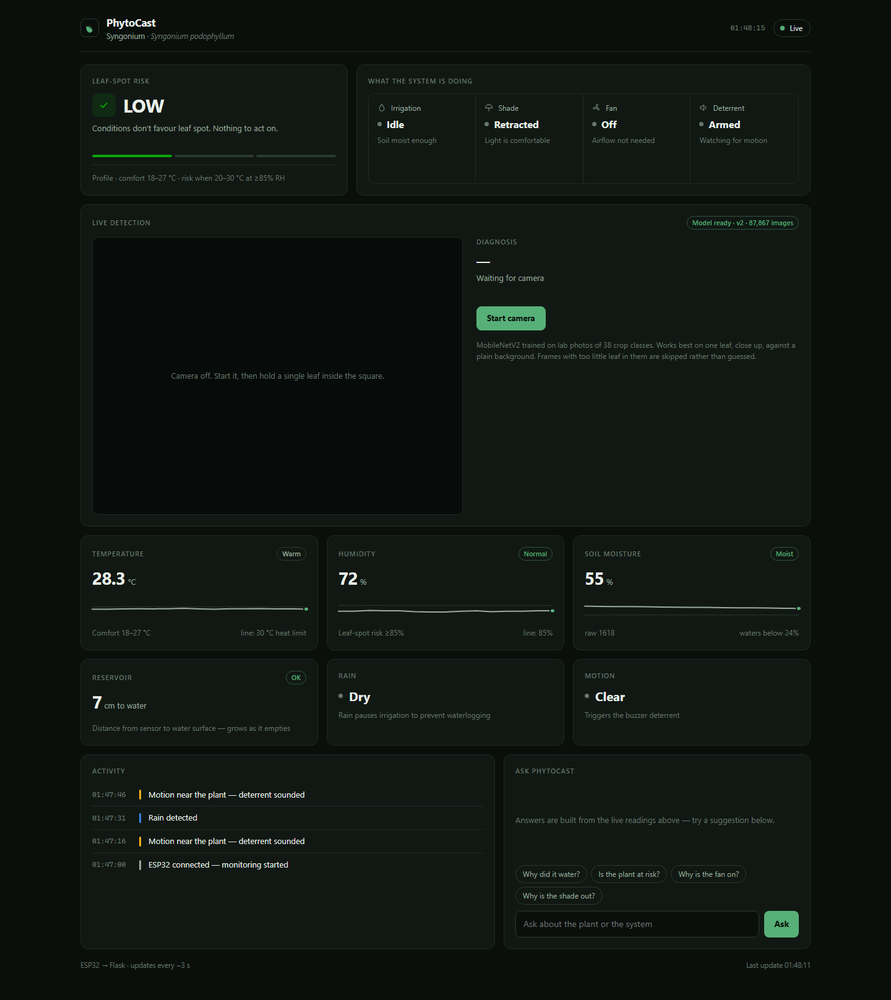
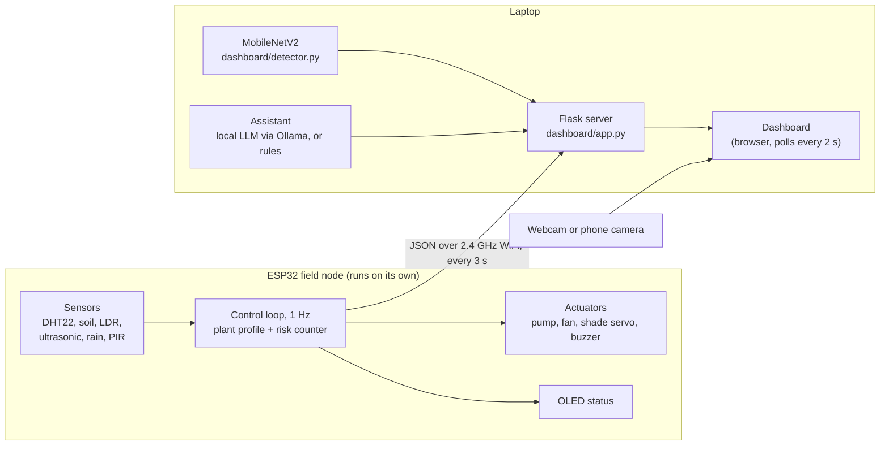

# PhytoCast

**A prevention-first smart plant-care system.** PhytoCast watches a potted plant's microclimate, forecasts leaf-spot disease *before* symptoms appear, and changes the conditions that cause it: watering, airflow, shade and pest deterrence, all from one ESP32. A laptop dashboard shows what the system is doing and why, and a MobileNetV2 model checks leaves through a camera as a second line of defence.

Built by a team of six for **EEE 2124 Electronics Laboratory** at United International University, Dhaka (2026).


<sub>The dashboard, running on simulated sensor data from `dashboard/send_test_data.py`.</sub>

## Contents

- [Why prevention](#why-prevention)
- [What it does](#what-it-does)
- [How it works](#how-it-works)
- [Hardware](#hardware)
- [Disease-detection model](#disease-detection-model)
- [Run it](#run-it)
- [Repository layout](#repository-layout)
- [Status and limitations](#status-and-limitations)
- [Documents](#documents)
- [Team](#team)

## Why prevention

Plant-disease apps identify a disease only after someone photographs a leaf that is already sick. Leaf spot on a *Syngonium podophyllum* (arrowhead plant) is driven by conditions you can measure: it spreads when the leaves stay warm and wet. So PhytoCast forecasts risk from temperature and humidity, and acts to push those conditions back out of the danger zone. Image detection is kept as a fallback, not the main defence.

## What it does

| Module | What it does | Status |
|---|---|---|
| **M1 Disease-risk forecast** | Raises a low, medium or high leaf-spot risk while temperature is 20 to 30 °C with humidity at or above 85%. A counter rises and falls one step per second, so a single noisy reading can't set or clear it. High risk switches on the fan. | Complete |
| **M1 Detection model** | MobileNetV2 classifier for 38 crop and disease classes, run on the laptop from a camera feed. | Model complete; live camera in progress |
| **M2 Irrigation** | Waters in 3-second pulses with a 60-second soak before re-checking, using a soil threshold calibrated in the real pot. Pauses while it rains. | Complete |
| **M3 Climate response** | Fan and shade servo react to heat, humidity, light and disease risk, with separate on and off humidity thresholds (80% / 75%) so the fan doesn't flicker. | Complete; shade panel not yet mounted |
| **M4 Water and rain** | Ultrasonic reservoir level (median of three echoes) and a rain sensor; the buzzer warns when the tank runs low. | Complete; alert level not yet calibrated |
| **M5 Pest deterrent** | A PIR sensor triggers the buzzer, ignoring the first 60 s while the sensor settles. | Complete; strobe LED not yet added |
| **M6 Dashboard and assistant** | Live risk, actuator states with the reason for each, trend charts, reservoir, rain and motion status, a timestamped log of every action, and a text assistant that answers "why did it water?" from the live data. | Complete |

All plant thresholds live in one profile block in the firmware, so adapting PhytoCast to another plant means changing that block only.

## How it works



The ESP32 reads every sensor once a second, applies the plant profile, drives the actuators and updates the OLED. Every 3 seconds it posts a JSON summary to the Flask server, and the dashboard asks the server for the latest state every 2 seconds. **Control never depends on the laptop:** if WiFi or the laptop drops, the plant is still looked after.

The assistant uses a local language model through [Ollama](https://ollama.com) when one is running, and falls back to built-in rules otherwise, so it also works offline.

## Hardware

| Component | ESP32 pin | Supply | Role |
|---|---|---|---|
| DHT22 temperature and humidity | GPIO 4 | 3.3 V | Risk forecast, climate (M1, M3) |
| SSD1306 OLED (I²C) | GPIO 21 SDA, 22 SCL | 3.3 V | Local status display |
| Capacitive soil moisture sensor | GPIO 34 (ADC) | 3.3 V | Irrigation (M2) |
| LDR module, digital out | GPIO 35 | 3.3 V | Light level (M3) |
| HC-SR04 ultrasonic | GPIO 5 TRIG, 18 ECHO | 3.3 V | Reservoir level (M4) |
| Rain sensor, digital out | GPIO 27 | 3.3 V | Rain detection (M2, M4) |
| HC-SR501 PIR | GPIO 19 | 5 V (VIN) | Motion (M5) |
| Relay channel 1, active-low | GPIO 23 | 5 V (VIN) | Pump |
| Relay channel 2, active-low | GPIO 32 | 5 V (VIN) | Fan |
| SG90 servo | GPIO 13 | 5 V (VIN) | Shade (M3) |
| Active buzzer | GPIO 17 | GPIO | Deterrent and tank alert (M4, M5) |

**Power:** three supplies on one common ground. The 3.3 V rail feeds the low-current sensors; 5 V from VIN feeds the PIR, relay coils and servo; an external 5 V 2 A adapter drives the pump and fan through the relay contacts, so motor current never passes through the ESP32.

**Plant profile (*Syngonium podophyllum*):** comfortable at 18 to 27 °C; above 30 °C the shade deploys and the fan runs; below 15 °C the fan is locked off; the soil counts as dry above a raw reading of 1,950, calibrated in the actual pot.

## Disease-detection model

The model was retrained after faculty feedback that the first dataset (PlantVillage, 54,305 images) was too small.

| | |
|---|---|
| Base network | MobileNetV2, pre-trained on ImageNet (transfer learning) |
| Data | [New Plant Diseases Dataset](https://www.kaggle.com/datasets/vipoooool/new-plant-diseases-dataset): 87,867 images (70,295 train, 17,572 validation), 38 classes across 14 crops |
| Training | Stage 1: new classifier on a frozen base (Adam, lr 1e-3, 3 epochs). Stage 2: last 30 layers unfrozen (lr 1e-5, 2 epochs). Flip, rotation and zoom augmentation; class weighting. Google Colab, T4 GPU. |
| Field test | [PlantDoc](https://github.com/pratikkayal/PlantDoc-Dataset): 2,578 real-world photographs, never seen in training |

| Evaluation | Result |
|---|---|
| Validation accuracy, stage 1 | 92.4% |
| Validation accuracy, after fine-tuning | **94.7%** |
| PlantDoc field photos, correct disease | 20.0% |
| PlantDoc field photos, correct crop | 41.3% |

Random guessing over 38 classes scores about 2.6%. The gap between lab images and field photos (cluttered backgrounds, natural light, several leaves in view) is exactly why the sensor forecast stays the primary defence. In the dashboard, frames with too little leaf are skipped, results are averaged over four frames, and anything under 70% confidence is reported as uncertain rather than guessed. There is no Syngonium class, because no public dataset of diseased Syngonium exists.

The full training notebook walkthrough is in [docs/ml-retraining-v2.md](docs/ml-retraining-v2.md).

## Run it

### Dashboard (no hardware needed)

```bash
cd dashboard
pip install -r requirements.txt
python app.py                 # http://localhost:5000
python send_test_data.py      # second terminal: a simulated ESP32
```

For live leaf detection, also install the model dependencies (`pip install -r requirements-ml.txt`). Browsers only allow the camera on `localhost`, so open the dashboard on the laptop itself. For the assistant's language model, install [Ollama](https://ollama.com) and run `ollama pull llama3.2`; without it, the assistant answers from rules.

### Firmware

1. Open `firmware/phytocast/phytocast.ino` in the Arduino IDE with the **ESP32** board package installed.
2. Install the libraries: *DHT sensor library* (Adafruit), *Adafruit GFX*, *Adafruit SSD1306* and *ESP32Servo*.
3. Copy `firmware/phytocast/secrets.example.h` to `secrets.h` in the same folder, and fill in your WiFi network and the laptop's address (`http://<laptop-IP>:5000/update`). The ESP32 joins **2.4 GHz** networks only. `secrets.h` is git-ignored.
4. Upload, then open the Serial Monitor at 115200 baud.

## Repository layout

```text
firmware/phytocast/   ESP32 program (all six modules in one loop) and the secrets template
dashboard/            Flask server and dashboard, detector, simulated ESP32
model/                Trained models: v2 (87,867 images, used by default) and v1, with class names
docs/                 Proposal, progress update, final report, model guides, screenshots
```

## Status and limitations

PhytoCast was submitted as a working prototype. Honest notes from the final report:

- **Live camera detection** is built and tested on still images, but not yet verified with a live camera. The ESP32-CAM was dropped because its programming board was unavailable, so the camera is a laptop webcam or a phone.
- The risk counter advances once a second so it can be demonstrated in class; real leaf-wetness models work over hours.
- Still to finish on the hardware: mount the shade panel, add the strobe LED with its resistor, calibrate the reservoir alert, and build an enclosure. The prototype is on a breadboard.
- The PIR, relay coils, servo and WiFi radio share the ESP32's USB supply, which may cause resets under heavy load.

## Documents

| Document | |
|---|---|
| [Project proposal](docs/project-proposal.pdf) | Problem, design and plan (6 pages) |
| [Progress update](docs/progress-update.pdf) | Mid-project status |
| [Final report](docs/final-report.pdf) | Implementation, calibration, testing, problems solved (6 pages) |
| [Climate response in Wokwi](docs/climate-response-wokwi-guide.pdf) | Simulating module M3 before building it |
| [ML model manual](docs/ml-model-manual.md) · [Retraining v2](docs/ml-retraining-v2.md) · [Model explained](docs/model-explained.md) | Training and understanding the detector |

## Team

| | |
|---|---|
| Rupsana Akter Joyria | Sadia Snigdha |
| Mst. Mahfuja Jerin | Sadia Noman Tonni |
| Ahmad Maruf Hossain | Mohammad Mahadi Hasan |

Department of Computer Science and Engineering, United International University. Course: EEE 2124 Electronics Laboratory.

This repository is shared to show the project. If you'd like to reuse the code or documents, please get in touch through [GitHub](https://github.com/SpicyFalcon619).
